# Загрузка данных из таблицы (документы, справочники, картинки) — внешняя обработка 1С

Внешняя обработка (`.epf`) для управляемых форм 1С:Предприятие 8.3. Позволяет вставить данные из Excel в таблицу на форме и загрузить их в **документы** (шапка + табличная часть) или **справочники**, а затем — **картинки** к элементам справочника по именам файлов.

- Файл обработки: `ЗагрузкаДанныхИзДокуметов_ТА_v8.epf`
- Исходный код формы: `Module_forms_v8.bsl`
- Платформа: 1С:Предприятие 8.3.27 (на ней проверялся синтаксис модуля), тонкий или толстый клиент

> ⚠️ **Перед использованием на рабочей базе проверьте обработку на копии.** Загрузка создаёт и перезаписывает объекты, а проведённые документы меняют учёт.

---

## Содержание

1. [Возможности](#возможности)
2. [Установка и запуск](#установка-и-запуск)
3. [Быстрый старт: загрузка документов](#быстрый-старт-загрузка-документов)
4. [Быстрый старт: загрузка справочника](#быстрый-старт-загрузка-справочника)
5. [Как подготовить данные в Excel](#как-подготовить-данные-в-excel)
6. [Как связываются шапка и табличная часть](#как-связываются-шапка-и-табличная-часть)
7. [Загрузка картинок](#загрузка-картинок)
8. [Проверки и сообщения об ошибках](#проверки-и-сообщения-об-ошибках)
9. [Форматы значений](#форматы-значений)
10. [Частые вопросы](#частые-вопросы)
11. [Ограничения](#ограничения)
12. [Для разработчиков](#для-разработчиков)
13. [История изменений](#история-изменений)
14. [Лицензия](#лицензия)

---

## Возможности

| Возможность | Описание |
|---|---|
| Два режима | **Документ** (шапка и табличная часть) и **Таблица (справочник)** |
| Вставка из Excel | Данные вставляются в таблицу на форме обычным копированием и вставкой |
| Умные заголовки | Колонки сопоставляются по названию (имя или синоним реквизита), порядок колонок не важен, лишние колонки пропускаются |
| Связь шапки и табличной части | По полю-ключу; ключ в табличной части проставляется автоматически |
| Создание и обновление | Найден объект по ключу — обновляется, не найден — создаётся (можно отключить создание) |
| Автономера | Пустые «Номер» и «Код» присваиваются автоматически |
| Проведение | Для документов можно сразу проводить |
| Картинки | Загрузка из папки, ключ — в имени файла (`10.jpg` → элемент с кодом 10), картинка по умолчанию |
| Защита от ошибок | Проверка данных и подтверждение с итогами перед загрузкой |
| Подсказки | Всплывающие подсказки у всех полей, пошаговая инструкция на форме |

---

## Установка и запуск

Установка не требуется — это внешняя обработка.

1. Скачайте `ЗагрузкаДанныхИзДокуметов_ТА_v8.epf` из репозитория [1C-Table-manager](https://github.com/Omorriiz/1C-Table-manager) (откройте файл на GitHub и нажмите «Download raw file»).
2. Запустите 1С:Предприятие (режим «1С:Предприятие», не конфигуратор) нужной базы.
3. Откройте меню **Файл → Открыть…** (или `Ctrl+O`) и выберите `.epf`.
4. 1С покажет предупреждение безопасности («Security warning / Предупреждение безопасности») — нажмите **«Да»**. Это стандартное окно для любых внешних обработок.

### Вариант 2. Встроить в конфигурацию

В режиме **Конфигуратор**: в дереве конфигурации правой кнопкой по ветке **«Обработки»** → **«Вставить внешний отчёт или обработку…»** (*Insert external report or data processor…*) и выберите `.epf`. После этого обработка будет доступна в самой конфигурации.

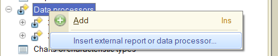

Также обработку можно подключить в справочник «Внешние обработки», если он есть в вашей конфигурации.

---

## Быстрый старт: загрузка документов

Форма разбита на **четыре шага**. Поля появляются по мере заполнения, лишнего на экране нет.

Так форма выглядит при открытии: пока ничего не выбрано, на экране только первый шаг, кнопки «Загрузить» и «Очистить» недоступны.

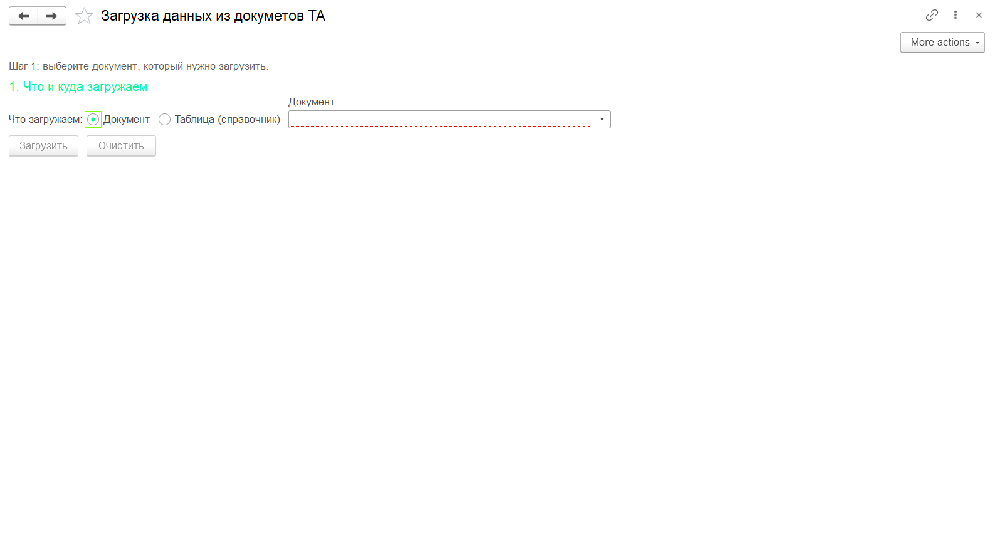

### Шаг 1. Что и куда загружаем

1. Переключатель **«Что загружаем»** — выберите **Документ**.
2. В поле **«Документ»** выберите вид документа (например, «Заказы»).
3. Если у документа есть табличная часть, флажок **«Есть табличная часть»** включится сам, а единственная табличная часть выберется автоматически.
4. **«Ключ (по чему искать)»** — поле, по которому ищется уже существующий документ. По умолчанию — **Номер**.
5. **«Ключ ТЧ»** — поле строки табличной части, в котором записан ключ документа (например, «Номер заказа» = номер документа). Подбирается автоматически.
6. **«Первая строка данных»** — по умолчанию `2` (строка 1 — заголовки).
7. Флажки: **«Не создавать новые»** (только обновлять существующие) и **«Проводить документы»**.

После выбора документа «Заказы» появляются остальные поля: табличная часть, ключи, первая строка и флажки, а ниже — таблица шапки с заголовками колонок. Ключ шапки («Номер») подсвечен жёлтым, ключ табличной части («Номер заказа») подобран автоматически.

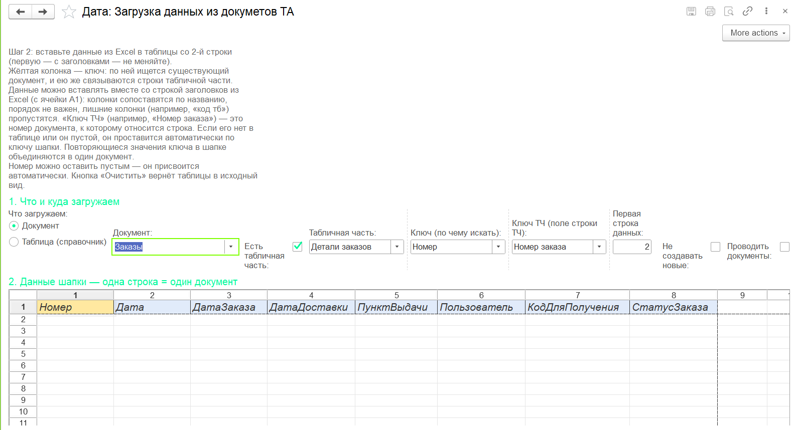

### Шаг 2. Данные шапки

Скопируйте данные в Excel и вставьте в таблицу **«Данные шапки»**. Можно вставлять сразу со строкой заголовков из Excel (с ячейки A1) — колонки сопоставятся по названию. Колонка с ключом подсвечена **жёлтым**.

### Шаг 3. Табличная часть

Вставьте строки в таблицу **«Табличная часть»** так же. Колонку с номером документа («Номер заказа») можно не заполнять — она проставится автоматически (см. [связь шапки и табличной части](#как-связываются-шапка-и-табличная-часть)).

Таблицы шапки и табличной части с заголовками колонок — сюда вставляются данные из Excel:

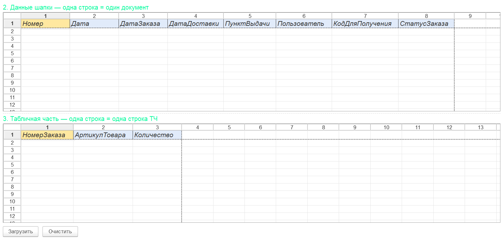

### Шаг 4. Загрузка

1. Нажмите **«Загрузить»**.
2. Программа проверит данные и покажет окно подтверждения: сколько объектов будет создано и обновлено, сколько строк табличной части, будут ли документы проведены, есть ли предупреждения.
3. Нажмите **«Да»**. По завершении появится уведомление, а подробный отчёт — в окне сообщений внизу.

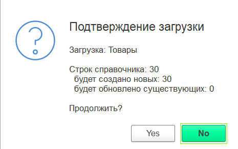
>
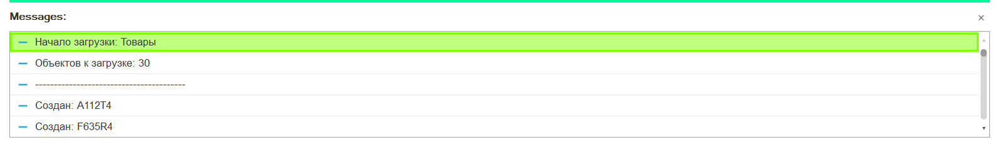

Кнопка **«Очистить»** удаляет вставленные данные и возвращает заголовки колонок (перед этим спрашивает подтверждение).

---

## Быстрый старт: загрузка справочника

1. Переключатель **«Что загружаем»** → **Таблица (справочник)**.
2. Выберите справочник (например, «Товары»).
3. Ключ по умолчанию — **Наименование**. Для справочников с кодами можно выбрать **Код**.
4. Вставьте данные в таблицу, нажмите **«Загрузить»** и подтвердите.

Код можно оставить пустым — он будет присвоен автоматически (если в справочнике включена автонумерация).

Начальный вид формы в режиме справочника:

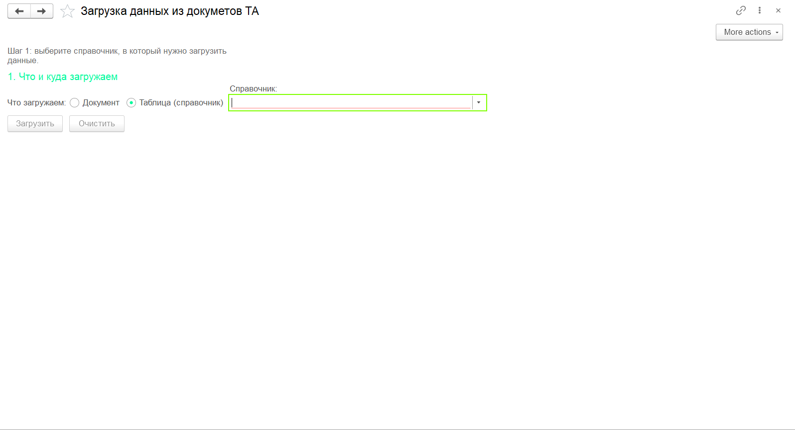

После выбора справочника «Товары» поля подстраиваются: ключ по умолчанию — «Наименование» (подсвечен жёлтым), табличных частей у справочника нет, поэтому флажок «Есть табличная часть» недоступен, вместо «Не создавать новые» стоит «Только обновлять существующие».

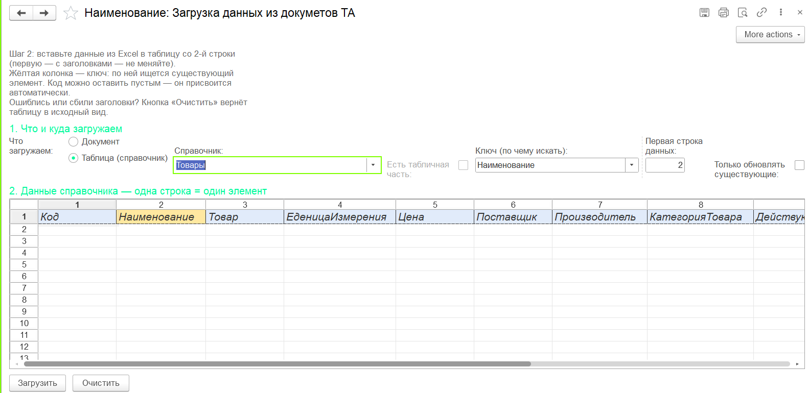

---

## Как подготовить данные в Excel

### Общие правила

- **Первая строка — заголовки колонок.** Названия могут быть именем реквизита или его синонимом («Артикул товара»), регистр и пробелы не важны.
- **Порядок колонок не важен.** Лишние колонки (например, «код тб») пропускаются — об этом будет предупреждение.
- **Одна строка = один объект** (в шапке) или одна строка табличной части.
- Пустые строки пропускаются.

### Шапка

Пример: в шапке только номера заказов. Повторяющиеся номера допустимы — они объединяются в один документ.

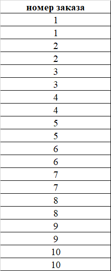

### Табличная часть

Пример подготовленной таблицы для табличной части «Детали заказов» (колонка «код тб» не нужна и будет пропущена):

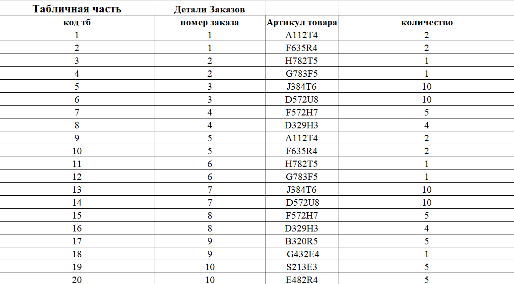

Колонки сопоставятся так: «номер заказа» → реквизит «Номер заказа», «Артикул товара» → «Артикул товара», «количество» → «Количество».

---

## Как связываются шапка и табличная часть

Строка табличной части попадает в тот документ, у которого значение ключа шапки (например, **Номер**) равно значению **«Ключ ТЧ»** этой строки (например, **Номер заказа**).

Чтобы вручную ничего не расставлять, ключи в таблице табличной части проставляются автоматически — при нажатии «Загрузить», только в **пустые** ячейки:

| Ситуация | Что происходит |
|---|---|
| Строк в шапке и в табличной части **поровну** | Ключ берётся из шапки «строка к строке» (в том же порядке) |
| Колонка ключа заполнена в первой строке документа, ниже пусто | Ключ продолжается с предыдущей строки |
| В шапке **один** документ | Его ключ ставится на все строки табличной части |
| Колонки ключа в таблице нет вообще | Колонка создаётся и заполняется |

Уже заполненные ключи **не перезаписываются**.

### Повторяющиеся ключи в шапке

Одинаковые значения ключа в шапке (`1, 1, 2, 2, …`) объединяются: получается **один документ на каждый уникальный ключ**. Если в повторяющихся строках значения разные, побеждает последняя непустая.

### Сопоставление ключей «10» и «000000010»

Ключи, состоящие только из цифр, сравниваются без ведущих нулей: `10` и `000000010` — одно и то же. При создании нового объекта строковый код/номер дополняется нулями до длины, заданной в метаданных.

---

## Загрузка картинок

Блок **«4. Картинки»** виден только в режиме справочника. Картинки привязываются к уже существующим элементам, поэтому **сначала загрузите данные, потом картинки**.

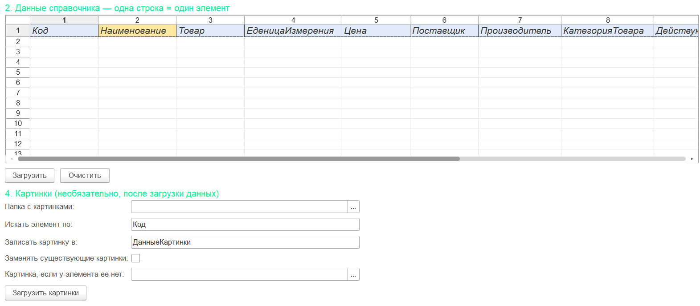

### Подготовка файлов

Имя файла содержит ключ элемента:

| Имя файла | Ключ |
|---|---|
| `10.jpg` | `10` |
| `10_фото.png` | `10` |
| `Товар 10 (2).png` | `10` |
| `000000010.jpg` | `10` |

Поддерживаются `jpg`, `jpeg`, `png`, `bmp`, `gif`.

### Настройки

| Поле | Назначение |
|---|---|
| **Папка с картинками** | Кнопка справа открывает выбор папки |
| **Искать элемент по** | Какое поле справочника сравнивается с ключом из имени файла. По умолчанию **Код** |
| **Записать картинку в** | Реквизит с картинкой (тип «Хранилище значения» или «Двоичные данные»). Подбирается автоматически |
| **Заменять существующие картинки** | Если выключено, у элементов с картинкой она остаётся прежней |
| **Картинка, если у элемента её нет** | Необязательно. Этим файлом заполнятся все элементы справочника без картинки |

### Порядок работы

1. Заполните настройки, нажмите **«Загрузить картинки»**.
2. Проверьте окно подтверждения (число файлов, ключ, режим замены, картинка по умолчанию) и нажмите **«Да»**.
3. Результат — в уведомлении и в окне сообщений: какие элементы получили картинку, для каких файлов не нашлось элемента.

Если на один элемент приходится несколько файлов, берётся первый по алфавиту, об остальных пишется в сообщении. Файл без подходящего элемента (например, `picture.png`) попадает в отчёт «не найден элемент» — это не ошибка.

> **Картинка по умолчанию.** Подстановка действует на **весь справочник**: после загрузки из папки все элементы с пустым реквизитом получают выбранный файл. Помеченные на удаление элементы и группы пропускаются.

---

## Проверки и сообщения об ошибках

Перед загрузкой запускается проверка. Одни проблемы блокируют загрузку (**ошибки**), о других предупреждают (**предупреждения**), и вы решаете, продолжать ли.

### Блокирующие ошибки

| Сообщение | Что сделать |
|---|---|
| Выберите документ / справочник | Выберите объект в шаге 1 |
| Выберите табличную часть | Выберите её или снимите флажок «Есть табличная часть» |
| Выберите «Ключ ТЧ» | Укажите поле табличной части с ключом |
| В таблице нет данных | Вставьте строки со 2-й строки |
| Первая строка данных больше числа строк | Уменьшите значение или добавьте данные |
| В первой строке нет заголовков | Нажмите «Очистить» и вставьте данные заново |
| Нет колонки ключа «…» | Выберите другой ключ или проверьте заголовки |
| Не удалось связать строки табличной части с шапкой | Сделайте одинаковое число строк в шапке и табличной части (в том же порядке) или заполните колонку ключа ТЧ |
| Нет реквизита для картинки | Добавьте в справочник реквизит типа «Хранилище значения» |
| Папка / файл не найдены | Выберите существующую папку и файл |

### Предупреждения

| Сообщение | Значение |
|---|---|
| Колонка «…» не найдена среди реквизитов — будет пропущена | Лишняя колонка не загрузится |
| Строк без значения ключа: N | Эти строки будут пропущены |
| Ключи табличной части, которых нет в шапке | Эти строки не загрузятся |
| Для N строк шапки нет строк в табличной части | Табличная часть этих документов останется как есть |
| Таблица табличной части пуста | Табличные части заполнены не будут |

### Окно подтверждения

Показывает итоги и напоминает о последствиях:

- сколько объектов будет **создано**, **обновлено**, **пропущено**;
- сколько повторяющихся строк шапки объединено;
- «Документы будут ПРОВЕДЕНЫ», если включено проведение;
- «Существующие объекты будут перезаписаны» — для обновляемых объектов их табличные части заполняются заново.

---

## Форматы значений

| Тип реквизита | Что можно писать в ячейке |
|---|---|
| Строка | Любой текст |
| Число | `1234`, `1 234,5`, `1234.5` (пробелы и запятая обрабатываются) |
| Дата | `27.02.2025`, `27.02.25`, `2/27/2025`, `2025-02-27`; с временем `27.02.2025 14:30` или `2/27/2025 12:00:00 AM` |
| Булево | `да`, `истина`, `1`, `+`, `включено` — истина; остальное — ложь |
| Перечисление | Представление значения, как оно выглядит в 1С (например, «Завершен») |
| Ссылка (справочник, документ и др.) | Наименование (для справочника также код, для документа — номер) |

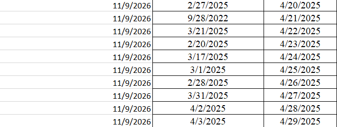

### Даты: как определяются день и месяц

- Число больше 12 — это день: `2/27/2025` = 27 февраля, `27.02.2025` = 27 февраля.
- Если оба числа не больше 12: разделитель `.` — «день.месяц.год», разделитель `/` — «месяц/день/год» (как отдаёт Excel с американскими настройками).
- Для неоднозначных дат с `/` (например, `5/4/2025`) используйте точки (`05.04.2025`), если нужен порядок «день.месяц».
- Двузначный год считается как 20xx.

---

## Частые вопросы

**Нажимаю «Загрузить» — ничего не происходит / кнопка серая.**
Кнопки доступны после выбора документа или справочника (шаг 1).

**«Не найдена колонка ключа».**
Ключ шапки по умолчанию — «Номер» (для справочника — «Наименование»). Проверьте, что в таблице есть колонка с таким названием, либо выберите другой ключ в поле «Ключ (по чему искать)».

**Все строки табличной части попали не в тот документ.**
Проверьте «Ключ ТЧ» — он должен указывать на поле, в котором записан номер (ключ) документа. Если число строк в шапке и табличной части не совпадает, ключи нужно заполнить в самой таблице.

**Даты загрузились неправильно (день и месяц наоборот).**
См. раздел «Даты». Используйте точки в качестве разделителя для формата «день.месяц».

**Картинки не загружаются, «не найден элемент для файла».**
Проверьте, что в поле «Искать элемент по» выбрано нужное поле (обычно «Код»), и что элементы уже созданы. Номер в имени файла должен совпадать со значением этого поля.

**Окно «Security warning» при открытии файла.**
Это стандартное предупреждение платформы для любых внешних обработок. Открывайте файл только из источников, которым доверяете.

**Нужно ли ничего менять в конфигурации?**
Нет. Обработка работает с любой конфигурацией и читает метаданные (документы, справочники, реквизиты) автоматически.

---

## Ограничения

- Картинки загружаются из папки на компьютере пользователя: нужен **тонкий или толстый клиент**. Выбор папки в веб-клиенте требует расширения для работы с файлами.
- Поддерживаются документы и справочники. Регистры сведений, планы видов характеристик и др. не загружаются.
- Ссылочные реквизиты составного типа загружаются как строка.
- Составные ключи (по нескольким полям) не поддерживаются.
- Загрузка выполняется одним серверным вызовом: для очень больших объёмов (десятки тысяч строк) разбивайте данные на части.
- Подстановка картинки по умолчанию действует на весь справочник, а не только на загруженные в этот раз элементы.

---

## Для разработчиков

Вся логика находится в модуле управляемой формы `Module_forms_v8.bsl`. Часть элементов интерфейса (переключатель режима, блок картинок, подсказки) создаётся программно при открытии формы (`ПриСозданииНаСервере`), поэтому структура формы в самом `.epf` не менялась.

Для проверки синтаксиса модуля можно использовать пакетный режим конфигуратора:

```bash
1cv8 DESIGNER /F <путь к пустой базе> /LoadConfigFromFiles <каталог выгрузки> /UpdateDBCfg
1cv8 DESIGNER /F <путь к пустой базе> /CheckConfig -ThinClient -Server -ExtendedModulesCheck
```

(обработка предварительно выгружается в файлы командой `/DumpExternalDataProcessorOrReportToFiles` и добавляется в тестовую конфигурацию).

---

## История изменений

| Версия | Изменения |
|---|---|
| v8 | Распознавание дат формата `М/Д/ГГГГ` (из Excel), AM/PM, двузначный год |
| v7 | Ключ связи — поле табличной части («Номер заказа»); сопоставление колонок по заголовкам; автозаполнение ключа |
| v6 | Объединение повторяющихся строк шапки, автоматическая расстановка ключей |
| v5 | Пошаговый интерфейс, подсказки, проверки данных, подтверждения |
| v4 | Картинка по умолчанию для элементов без картинки |
| v3 | Загрузка картинок из папки по имени файла |
| v2 | Режим «Таблица (справочник)», исправлена очистка, автономера |
| v1 | Исходная обработка: загрузка документов с табличной частью |

---

## Лицензия

Проект распространяется по лицензии [MIT](LICENSE): использование, копирование и изменение разрешены при сохранении текста лицензии. Обработка предоставляется «как есть», без гарантий — перед использованием на рабочей базе проверьте её на копии.
